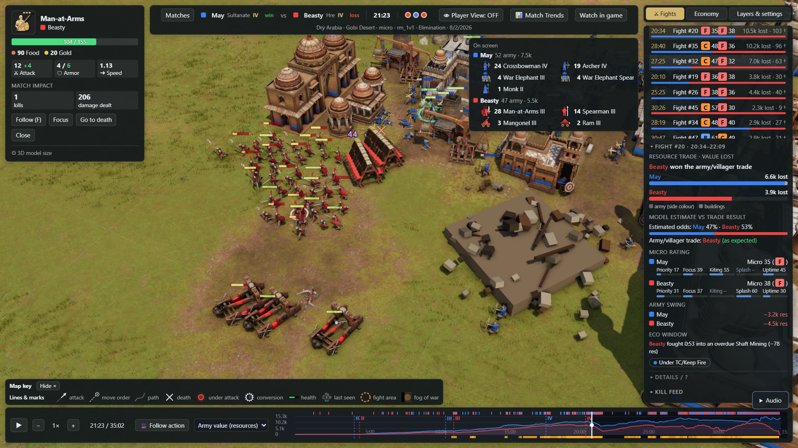
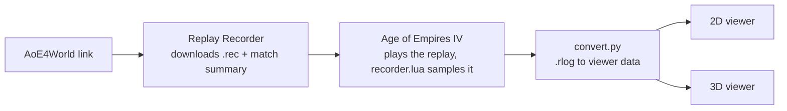
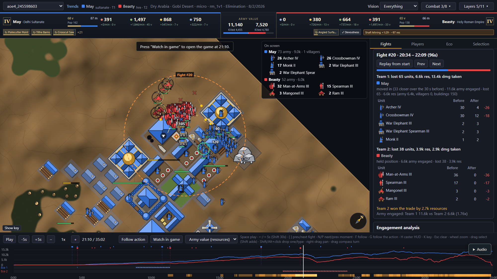
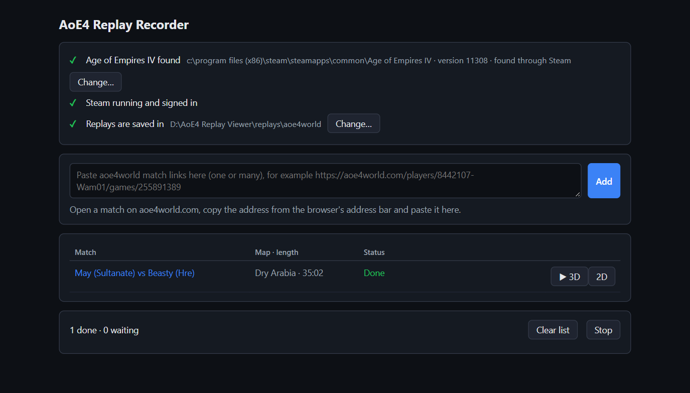

# AoE4 Replay Viewer

A fan-made replay viewer for **Age of Empires IV**. Paste an [AoE4World](https://aoe4world.com) match link, and the
Replay Recorder downloads the replay, plays it back in your own copy of the game to record every unit, then opens it
in a **2D tactical map** or a **3D battlefield** you can scrub, pause and inspect.



<p align="center"><sub>3D viewer: the included showcase match, 21:23. Beasty's men-at-arms, rams and mangonels break into
May's town; the Fights tab shows that fight's card (value lost, pre-fight odds vs the actual winner, grades) and the
unit card follows a selected man-at-arms.</sub></p>

## Why it needs the game

An AoE4 `.rec` file holds only the players' commands ("villager 12, chop this tree"), not where anything was. To get
positions, the real game has to play the replay. The recorder starts the replay in AoE4, sends a small Lua script
(`recorder/recorder.lua`) through the dev console in the background, and fast-forwards. Twice per game second the
script records every unit's and building's position, health, owner, attack target and what each player can see,
plus the height map and every tree, mine, animal and relic. A 10-minute game records in about 80 seconds.



## Screenshots

| 2D tactical map | Replay Recorder |
| --- | --- |
|  |  |
| Minimap-style map with unit figures, fog of war, fight detection and per-fight inspector, army comp and an army-value timeline. | Paste links, watch each match record, then open it in 2D or 3D. |

## Try it without the game

The repository includes one recorded match: **May (Delhi Sultanate) vs Beasty (Holy Roman Empire)** on Dry Arabia,
35:02, game 245598603 ([AoE4World](https://aoe4world.com/players/10307814-May/games/245598603)). Both viewers open it
by default.

- **2D:** open `viewer/index.html` in a browser. It runs straight from disk; nothing to install.
- **3D:** install [Node.js](https://nodejs.org/) 20 or later, then run:

  ```
  node viewer3d/serve.mjs
  ```

  and open <http://127.0.0.1:8080/>. Game models are **not** included (see [3D models](#3d-models)), so until you
  build them from your own installed game, units and buildings show as simple owner-coloured stand-in shapes on the
  recorded height map.

## Record your own matches

**Needs:** Windows 10/11, Steam with Age of Empires IV installed, signed in. Python is included (`python/`,
Python 3.12 embeddable package with `psutil`).

1. Double-click **`Replay Recorder.bat`**. It opens <http://127.0.0.1:47811/> in your browser and checks that the game
   and Steam are found. It also starts the 3D viewer on port 8080 when Node.js is installed.
2. On aoe4world.com, open a match page and copy the address, for example
   `https://aoe4world.com/players/10307814-May/games/245598603`.
3. Paste one or more links into the box and press **Add**. Each link downloads the replay from the official Age of
   Empires server (the player must share match history), saved as `replays/aoe4world/aoe4_<game id>.rec`, plus
   AoE4World's match summary (scores, APM, result) beside it as `.summary.json`.
4. The match records in the game, one at a time, with progress on the page. Close the game first; recording runs in
   the background and never takes focus. You can keep using the PC.
5. When the row says **Done**, press **2D** or **▶ 3D**.

The replay must come from the game version you have installed; matches from another version are flagged rather than
recorded. Old matches may no longer be on the server.

The list is kept in `recorder_app.json`, so closing the window and starting again continues where it stopped.
**Watch in game**, in both viewers, opens AoE4 on the same replay and fast-forwards to the moment you are looking at.

### From the command line

```
python\python.exe tools\record_replay.py path\to\replay.rec   # record one replay (or a folder of them)
python\python.exe tools\record_replay.py                      # your last match (the game's playback\temp.rec)
python\python.exe tools\convert.py recordings\<name>.rlog <replay.rec>   # re-convert a recording
python\python.exe tools\trends.py                             # rebuild viewer/data/trends/games.js
```

`Record replays.bat` records everything under `replays/` that has no complete recording yet. The output is
`recordings/<name>.rlog` (raw records) and `viewer/data/<name>.js` (viewer data, listed in `viewer/data/index.js`).

## Using the viewers

| | 2D (`viewer/index.html`) | 3D (`viewer3d/`) |
| --- | --- | --- |
| Pick a match | menu at the top left | **Matches** button |
| Layout | the map with a tabbed side panel (Unit, Fights, Eco and the rest) | top bar (players, clock, victory timers, **Player View**, **📊 Match Trends**, **Watch in game**), the map, and one drawer on the right with three tabs (Fights, Economy, Layers & settings); clicking the open tab collapses it. **Player View** shows whose vision, camera or unit the view follows; one click returns to the free spectator view |
| Play / seek | `Space`, `←`/`→` 5 s (`Shift` 30 s), click the timeline | same |
| Speed | `+`/`-` (0.25x to 32x) | same |
| Fights | `[` / `]` previous/next; the Fights tab lists every fight with losses per side and each side's Micro Rating badge | `[` / `]`; the Fights tab lists every fight, **Most impactful** first (resources both sides lost, plus forced villager idle time and the army swing) or **Chronological**, with each side's Micro Rating badge and a bar of what each side lost |
| Engagement analysis | Fights tab, under the selected fight: who won and the value each side lost, the pre-fight odds against the actual winner (upset or as expected), each side's S/A/B/C/F grade and the position tags (Under TC/Keep Fire, Chokepoint, Surround/Flank, Raid / Eco Hit); **Details / ?** opens the Micro Rating parts, Lanchester win probability, what-if +1 armour / +1 attack, the cost-efficiency tug-of-war chart (click to seek), idle army and late reinforcements, target-fire shares and eco casualties | the same card under the Fights list |
| Target fire | **Target fire** box (or the panel's own box): attack lines coloured by target choice, green good, yellow ok, red poor | **Target fire** in Overlays: the same colours on the attack lines |
| Vision | everyone, or one player or team with fog of war | same |
| Camera | wheel to zoom, right-drag to pan, drag the compass to turn | right-drag orbits, middle-drag (or Shift+right-drag) pans, wheel zooms, WASD / Q / E move |
| Player cameras | **Cameras** box: each player's view outlined on the map | **Camera** menu or `C`: watch through a player's camera; drag, wheel or WASD returns to the free camera |
| Map marks | deaths, move orders and paths; **Attacks** enables attack lines; **Target fire** colours those lines by target choice and requires **Attacks**; **Alerts** enables under-attack rings in the attacked player's colour (for the Vision setting's players and their allies); **Range rings** shows selected units' maximum weapon range in their owner's colour (up to 40 rings; excludes short melee ranges). All four boxes default off. Conversions: a ticked ring at the monk's reach while it channels, its targets ringed, a burst where a unit changes hands; sacred sites: a turning dashed ring and a 30 s progress arc while religious units take one (inferred from their positions), a flash on capture, all sites pulsing while one team holds them all (**Key** lists them) | the same marks on the terrain: kill markers, attack lines, move orders (**Orders**; **Eco orders** adds gatherers' and builders'), unit trails, alerts, conversions and flips, sacred-site states and progress arcs, player camera outlines (**Cameras**), and `K` or **Key** for the legend of lines and marks |
| Army on screen | **On screen** panel: each player's army and villagers inside the view; **Labels** names the units when zoomed in | **Army on screen** panel (the units in the view), **Unit names** when zoomed in |
| Key moments | **Moments** tab lists the notes in `viewer/notes/<name>.js`; `N` / `P` step through them, `Esc` closes the caption; `index.html#<name>/<n>` opens moment *n* | the same: **Moments** list in the side panel, `N` / `P`, `Esc`, `#<name>/<n>`; notes are read from the 2D folder |
| Timeline | army value, military or villager curves per player (menu), age-up and fight marks | the same, plus a hover tooltip with each player's value |
| Select | click a unit; `F` follows it; drag a box to select a group (Shift+drag adds); Shift+click adds or drops one unit, Alt+click drops every selected unit of its type | the same with the left button: click, box, Shift / Alt+click, `Esc` clears |
| Stat card | Explorer-style official portrait, age, class and online description; hitpoints, per-weapon attacks and bonus damage, melee/ranged armor with base ↗ upgraded values and segmented bars; DPS, move/attack speed and range; live dealt/taken damage, kills, healing received, DPS uptime and target grade. Owner, HP bar, cost, death details and collapsed **Debug info** remain. Descriptions load lazily from AoE4 World's unified data; offline, local stats and map-art fallbacks still work. | name, owner, HP bar, cost, attack, armour, range and speed (base and the owner's upgrades at *t*; bonus damage and upgrades in tooltips), kills and damage dealt, death details and **⚙ 3D model size**; **Debug info** appears when **Debug info on the unit card** is on |
| Victory conditions | | top bar: the sacred sites in their holder's colour, a 10:00 **Sacred victory** countdown while one team holds every site (it ends when a site is lost), **Wonder constructing (player)** while an Age IV wonder is built, then a 15:00 **Wonder victory** countdown and the wonder's HP |
| Under-attack notices | | a notice on the left edge when an enemy hits a player where they had no alert within 50 m for 15 s ("⚔️ Beasty attacking Mali Lee's Villagers"); click to jump there, the map ring pulses at the spot, it fades after 5 s; **Under-attack notifications** in Layers & settings mutes them |
| Selection tray | several selected: one icon per blueprint with a count and health; click drops one, right-click (or Alt+click) drops that blueprint | the same tray |
| Combat FX | Separate **Damage**, **Heals** and **Projectiles** boxes default on: floating damage numbers (red melee, orange pierce, gold siege, purple bonus damage; rising and fading over 0.6 s), green heal `+` particles, emerald rings and monk tethers, and projectiles including lobbed siege stones with muzzle flashes. **Splash rings** defaults off; measured 2D mangonel bands and siege reload cues are described below | **Combat FX** in Overlays: the same numbers as sprites (also under **Damage numbers & flash**), siege arcs with a muzzle ring, the three splash rings on the terrain, and heals as rising `+` particles, a glowing base ring and a tether beam |
| Eco opportunity cost | **Eco** tab: for Wheelbarrow, Double Broadax, Horticulture, Specialized Pick and Shaft Mining, one row per upgrade per player: Upgrade, Timing (researched vs the opponent's time or the typical time), Missed gather value, and a Verdict (On time, Delayed (no attack), Used tempo to attack); click a row to seek; **How is this calculated? (?)** explains the method | **Upgrade opportunity cost** atop the Economy tab: the same table |

- **Splash rings** (2D, default off): mangonel landings grow/fade through a red ≤2 m full-effect disc, orange 2–4 m ≈40 % band and dashed yellow 4–5.5 m ≈10–15 % edge; matched-control measurements from 22 recordings (`harvest/analysis/SUMMARY.md`). Other splash shooters keep their existing display bands.
- **Projectiles** (2D, default on): visible siege engines show a thin reload arc filling over their upgraded weapon period since the last recorded shot (contact strike for rams), held full until two periods after firing, plus a brief shot flash; independent of Splash rings and Alerts.

Links can name a match and a time: `index.html#aoe4_245598603/t1280` opens 21:20.
In 2D, resizing the map or toggling the caster dock preserves camera framing, including moment-link focus.
Focused controls keep their native keyboard actions (Space opens Combat/Layers instead of toggling playback).
Portrait and description lookups share pending requests and retain failed results for the session; missing portraits
keep the local map art. The card's healing received advances at recorded HP rises, capped at each heal session's total.
`viewer/trends.html` compares one player's numbers across all recorded matches (age-up times, villagers at 10:00,
army at 15:00, resources banked, fight trades); the 3D page opens it from **📊 Match Trends**.

## 3D models

The 3D viewer uses the game's own models, textures and animations, but this repository ships none of them. You build
them on your PC from your installed copy of Age of Empires IV:

1. Put the extraction toolchain in a `toolchain/` folder at the project root (or set `AOE4_REBUILD` to another
   folder):
   - `toolchain/tools/essence/`: the CLI from [AOEMods.Essence 0.7.0](https://github.com/aoemods/AOEMods.Essence/releases/tag/0.7.0)
     (`AOEMods.Essence.CLI.dll` and its files).
   - `toolchain/tools/dotnet/`: a .NET runtime (6 or later), for example with Microsoft's
     [`dotnet-install.ps1`](https://learn.microsoft.com/dotnet/core/tools/dotnet-install-script)
     `-Runtime dotnet -Channel 8.0 -InstallDir toolchain\tools\dotnet`.
2. Install the build scripts' packages: `npm ci` in `viewer3d/tools/`.
3. In `viewer3d/`, build the models and bake the animations:

   ```
   node tools/build-assets.mjs --all            # every civilization and map object, once (about 45 min, ~5 GB)
   node tools/build-assets.mjs --replay aoe4_245598603   # or only what one match uses (a few minutes)
   node tools/havok/bake-anims.mjs
   ```

The game is found through Steam (set `AOE4_ARCHIVES` to its `cardinal/archives` folder if it isn't), and archives
are unpacked into `toolchain/content-local/extracted/`. The output goes to `viewer3d/assets/`, which Git ignores.
Once the toolchain is there, Replay Recorder builds whatever a newly recorded match is missing by itself.

The **Graphics** setting in the 3D viewer switches between High and Low (fast) quality for weaker GPUs.

## Project layout

| Path | What it holds |
| --- | --- |
| `Replay Recorder.bat`, `Record replays.bat` | Double-click launchers (run `python\python.exe`) |
| `recorder/recorder.lua` | The in-game recorder script (record format documented in its header) |
| `tools/recorder_app.py`, `.html` | Replay Recorder: the local page on 127.0.0.1:47811 |
| `tools/record_replay.py`, `aoe4input.py` | Starts the game on a replay, types into its console in the background, fast-forwards, collects the log |
| `tools/recfile.py` | `.rec` parser (build, players, map, train/build/research commands, abilities, player cameras) |
| `tools/convert.py`, `rlog.py` | `.rlog` + `.rec` to viewer data: fights, kills, army value, techs, player cameras, conversions |
| `tools/trends.py`, `fetch_replays.py`, `check_units.py` | Trends data, replay download, unit-class check after game updates |
| `viewer/` | 2D viewer (Canvas 2D, no dependencies); `data/` holds the recordings both viewers read |
| `viewer3d/` | 3D viewer (three.js r186): `serve.mjs` (serves the 3D page and mounts `viewer/` at `/shared/`, so the 3D page loads the 2D `model.js`, `map.js`, `data/`, `notes/` and `trends.html`; `/shared/notes.json` lists the notes), `viewer.js`, `marks.js` (ground marks: orders, trails, alerts, sacred sites, conversions, cameras), `panels.js` (map key, army on screen, unit names, moments), `hud.js` (victory timers, under-attack notices), `core/` (shared replay model), `tools/` (model build, `build-stats.mjs`, `parity-check.mjs`) |
| `viewer/stats.js` | Generated unit / building / technology statistics (`window.RV_STATS`) both viewers read; never edited by hand |
| `viewer/frame.js` | The view-model both viewers share (`window.RV_FRAME`): the combat index and the per-frame render state |
| `viewer/card.js` | The unit stat card and selection tray both viewers draw (`window.RV_CARD`) |
| `viewer/fx.js` | The combat FX look both viewers share (`window.RV_FX`): colours, timings, arcs, and the 2D drawing |
| `viewer3d/fx3d.js` | The 3D combat FX: pooled quad batches fed each frame from the frame state |
| `viewer/eco.js` | The eco opportunity-cost engine both viewers share (`window.RV_ECO`) |
| `viewer/ecopanel.js` | The eco panel both viewers draw from it (`window.RV_ECOPANEL`) |
| `viewer/fights.js` | The engagement analysis both viewers share (`window.RV_FIGHTS`) |
| `viewer/fightpanel.js` | The engagement panel and rating badges both viewers draw from it (`window.RV_FIGHTPANEL`) |
| `replays/`, `recordings/` | Downloaded replays and raw recordings (only the showcase match is committed) |
| `python/` | Python 3.12 embeddable package (PSF license) with `psutil` |
| `reference/` | How-it-works flowchart and older 2D viewer pictures |

`node viewer3d/tools/parity-check.mjs [name]` checks that the 3D viewer's replay model agrees with the 2D viewer's on
a recording (exit code 0 = `parity OK`).

### Unit statistics

`viewer/stats.js` (committed, about 1.2 MB) holds hit points, armor, cost, speed, weapons with their bonus-damage
modifiers, technology effects and attack timings for every unit, building and technology, keyed by blueprint name. It is
generated from [data.aoe4world.com](https://data.aoe4world.com/) (`units`, `buildings`, `technologies` `all.json`) and,
when it exists, `viewer3d/assets/combat.json` (the game's own attack timings, built with the 3D models above):

```
node viewer3d/tools/build-stats.mjs                 # download the aoe4world data and rebuild viewer/stats.js
node viewer3d/tools/build-stats.mjs --from <dir>    # read units_all.json, buildings_all.json, technologies_all.json from a folder
```

Needs Node 18 or later, no packages. Rerun it after a game update, once `build-assets.mjs` has refreshed `combat.json`.
Names and numbers come only from that data, never from memory: technologies renamed in a patch follow it (gold III,
once Acid Distillation, is Shaft Mining), and `tools/convert.py` reads the tech-table names from `stats.js` too.
Effects that only last while an ability runs or near a building (`k: "ability"`, `"influence"`) are not applied to a
unit's stats; bonus damage against a class (`tc`) is added only against that class. A few villager gather techs have
no structured effect in aoe4world (Shaft Mining, Draft Horses); their rate is read from the description
(`src: "desc"`).

### Shared combat view-model

`viewer/frame.js` turns a recording into the combat facts both viewers draw, so the 2D map and the 3D scene show the
same events at the same moment:

- `RV_FRAME.combat(ents, data)` builds the combat index once per recording: timed melee strikes and shots from the
  recorded attacker/target pairs and the attack timings in `stats.js`, killing blows, guessed tower and keep arrows,
  damage numbers typed by the weapon that caused them, splash hits, heals and target-priority grades.
- `RV_FRAME.controller(index)` is each viewer's `FrameRenderState`: `selectedUnitIds`, `hoveredUnitId`, and for a
  time *t* the `activeProjectiles`, `activeImpacts` (splash shots landed in the last 0.5 s), `activeHeals`,
  `floatingDamageEvents` and `activeEngagementLines` lists. The lists come from the recorded tracks alone, never from
  a viewer's drawing positions. Both viewers use these lists and `RV_FX` for event timing; 2D additionally draws
  measured mangonel falloff bands and per-engine reload cues from the combat index and weapon stats.
- `RV_FRAME.statsAt(index, unit, t)` and `RV_FRAME.telemetry(index, unit, t)` give a unit's stats with its upgrades,
  and its damage dealt and taken, kills, DPS uptime and target-priority grade, up to *t*. `RV_FRAME.cardData` puts
  both in the rows the stat card (`viewer/card.js`) shows, base next to upgraded.

`parity-check.mjs` builds the index over both viewers' entity tables and compares the blows, damage numbers, heals
and the five lists at 120 times, and the splash impacts just after every splash landing.

### Eco opportunity cost

`viewer/eco.js` audits the villager gather techs listed above; their names, costs, research times and multipliers come
from `stats.js`, so civ variants (Delhi's free but slow research) count as the player researched them.

- Benchmark: the opponent's start of the same tech re-timed to this player's research time, when the opponent
  started earlier; otherwise the player's own age arrival plus an assumed pro offset (`RV_ECO.BENCH`).
- Missed = Σ gatherers × (rate with − rate without) × dt from the benchmark to the actual research (to the end of the
  replay when never researched). Gatherers come from the recorded jobs; the base rate per villager is measured from
  each player's bank and spend, because the recording has no gather rates. Net Eco Deficit = missed − cost.
- Capitalized YES needs both: the bank stayed below the cost while most of the spend went to military or defences
  (checked over at most the first 180 s of the delay), and an impact in the tempo window 90–180 s after the
  benchmark (enemy villagers idled, kills, building damage, or a held defence). Otherwise NO (Pure Eco Deficit).
- Wheelbarrow changes carry capacity and speed, not gather rate; it is modelled as shorter trips with an assumed
  share of walking time per resource (`RV_ECO.WALK_SHARE`).

`parity-check.mjs` compares every eco row and missed-resources curve over both viewers' combat indexes.

### Engagement analysis

`viewer/fights.js` reads one fight from `d.fights` (window `start`–`end`, area 1.5 × its radius) and the combat index;
its header comment carries the full method and the measurements behind each constant.

- Micro Rating = 35 % target priority (mean efficiency of each attack against the best target in reach) + 25 %
  overkill (1 − wasted share / 0.20; waste = damage past the victim's last HP, using the measured blow-count factors
  `KAPPA`, plus shots landing on dead targets) + 25 % uptime (ranged units' attack time over what a unit attacking
  non-stop shows) + 15 % splash (share of siege shots hitting 2 or more targets, over 0.25). A side with no splash units
  has the other three weights renormalised. Letters: S ≥ 90, A ≥ 75, B ≥ 60, C ≥ 45, otherwise F.
- Win probability: Lanchester square law. Each side's strength is total dps against the enemy's mix × total HP at the
  fight's start, from `stats.js` records with the upgrades researched by then. p = logistic(ln(P_A / P_B) / 1.5). The
  1.5 is fitted to the showcase match (Brier 0.198 against 0.250 for coin flips), not derived. The what-if boxes add
  armour or attack to one side and recompute p and the expected losses.
- Idle: army in the area that moved under 4 m and did not attack over the trailing 15 s. Late: first in the area more
  than 20 s after the start.
- Position tags: Chokepoint (free width 3–16 m, closed on both sides), Surround/Flank (attackers outside the densest
  90° arc), Under TC/Keep Fire (damage by buildings), Raid / Eco Hit (credited to the attacker when villagers and eco
  buildings are over half of what the other side lost there and at least 150 resources). AoE4 has no hill damage
  bonus, so there is no high-ground tag.
- Fight impact (the list's ranking number, resources) = value lost by both sides + the forced villager idle time
  (villager-seconds × 0.6 resources) + the army swing (|lost A − lost B|).
- Target fire grades each attack by its efficiency: good ≥ 0.8, ok ≥ 0.4, otherwise poor (`RV_FRAME.PRIO_GOOD` /
  `PRIO_OK`).

`parity-check.mjs` compares the fight list and every fight's analysis (ratings, Lanchester and what-if, tug of war,
idle and late counts, tags, target-fire shares, eco casualties) over both viewers' combat indexes.

## Limits

- Recording starts a few seconds into the game; units are sampled every 0.5 s, map objects every 10 s.
- The game exposes no water flag, so water is inferred from where fish sit (one level per map). Maps without fish
  get no water. Cliffs show only as steep slopes.
- Fog of war uses plain sight circles: no hill bonus, no sight upgrades; stealth forests don't hide units.
- The recording has no damage, projectile or heal events. Damage is the HP lost between two samples (one number can
  sum several hits), typed by the weapon of the unit attacking it. Heals are HP gains within 8 m of an allied monk.
  The 2D mangonel bands summarize matched-control falloff over 22 recordings (full effect ≤2 m, ≈40 % at 2–4 m,
  ≈10–15 % near the 4–5.5 m edge), not exact damage predictions. Other splash shooters and 3D retain the shared
  5/6.25/7.5 m display convention; splash-hit attribution remains within 5 m.
- In 3D, ships and siege engines are static models (no rig support yet).
- Watch in game fast-forwards at the game's own playback speed, so reaching the late game of a long match takes a
  few minutes.

## Legal

Age of Empires IV © Microsoft Corporation. AoE4 Replay Viewer was created under Microsoft's
["Game Content Usage Rules"](https://www.xbox.com/en-US/developers/rules) using assets from Age of Empires IV, and it
is not endorsed by or affiliated with Microsoft.

This repository contains no game files: no models, textures, animations or sounds. The 2D map art is drawn by this
project. The 3D models are built locally from your own installation and never leave your PC. Match data comes from
AoE4World and the official Age of Empires stats API.
