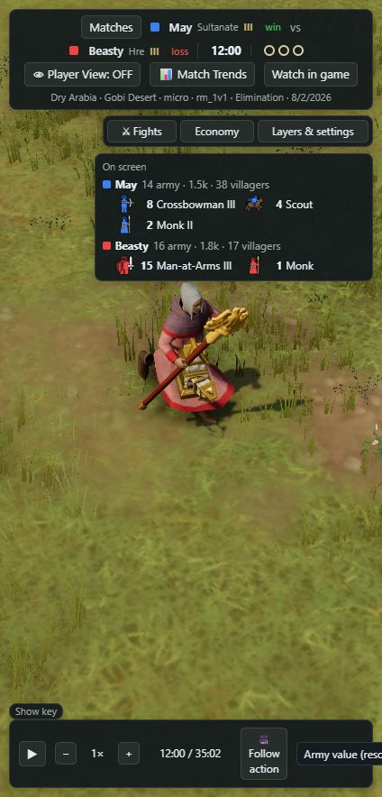

# Animation, audio and calculation follow-up

Date: 2026-10-23. Scope: current local animation pack, renderer state selection, relic recordings, shared fight and economy panels, and a concrete proposal for original AoE4 audio. Existing unrelated working-tree changes were retained.

## Implemented

- **Relic carrying:** `core/replay.js` links a moving relic to a unique living religious unit only after two consecutive matching segments. Each segment must be at most 2.1 seconds, move at least 0.25 world units, and have the same uniquely matching monk within 0.75 units at both endpoints. A single continuous alive span is required. Static proximity does not establish pickup; conflicting claims are rejected.
- **Existing carry clips now selected:** `base_monk` already mapped `carry_idle`, `carry_walk`, and `carry_run` to the game's relic idle/walk/jog clips. The renderer previously selected carrying only for villager job codes. Confirmed relic intervals now select these poses and suppress ordinary stop/heal poses while carrying.
- **Relic mesh follows the hands:** the current separate Gaia relic mesh is centred between the monk's animated palm sockets. Socket positions use the same sampled frames, clip blend and instance transform as the GPU animation. The inspected HRE, Sultanate and Jin models have staff props but no built-in relic mesh. The carried mesh uses a presentation scale; mounted rider socket transforms are deliberately unsupported.
- **Conversion channel:** the renderer now uses the shared conversion windows already used by the conversion rings to play the conversion clip, rather than relying on a damage attack to select it. Channel timing still inherits the shared model's inferred six-second window, clipped to the caster's alive span; cancellation is not explicitly recorded.
- **Fight what-if:** selecting side B previously displayed side A's probability and delta under side B's name. Text now complements both probabilities and reverses the delta for side B; the A/B bar remains in its existing orientation.
- **Calculation explanations:** the economy explanation now includes a numerical example and identifies inferred gather rates and Wheelbarrow assumptions. Verdicts say “Used military tempo” / “No tempo evidence”; failing the heuristic does not establish that no attack occurred.
- **Fight meanings:** “Resource trade” explicitly compares army/villager losses. Model odds are labelled estimates, with their assumptions and small calibration set disclosed. The nearby-kill chart explains why it can differ from the loss card.

## Verification and limits

`node viewer3d/tools/animation-assets-audit.mjs` checks local GLB animation names/channels, positive timing metadata, state references, blueprint archetype references and unreferenced clips. Result: **36 archetypes, 490 clips, 939 blueprints; zero errors or warnings**. This establishes structural consistency, not that every animation has been visually watched or every runtime state is reachable.

`node --test tools/tests/*.test.mjs viewer3d/tools/*test.mjs`: **52 tests pass**. New coverage includes relic ambiguity, static proximity, recording gaps, transfers, duplicate claims, seeking, carry pose selection, conversion windows, socket interpolation and the actual fight panel's side-B what-if text.

Parity check exit code: **0**.

Production carrier matching was exercised on three existing recordings:

| Recording | Confirmed intervals | Relics | Monks | Inferred carrying seconds |
| --- | ---: | ---: | ---: | ---: |
| aoe4_245598603 | 12 | 7 | 7 | 310 |
| aoe4_244579968 | 10 | 7 | 4 | 308 |
| aoe4_256829909 | 9 | 7 | 5 | 609 |

Reproduction: default match at **12:00**, monk `1000006237`, relic `1000005487`, position `(23.65, -88.30)`. Confirmed interval is 691.25–749.25 seconds. A browser close-up verified the carried mesh. The fight panel was checked on fight #55: side B +1 armour displays **Beasty 80% → 81% (+1.1 pt)**.

### Still incomplete

1. **Exact pickup/deposit:** no dedicated pickup/deposit clips exist in the current monk pack, and no explicit carrier/pickup/deposit fields were found in the 213 replay schemas inspected. Gaia disappearance alone is not proof of deposit. Current inference ends at the last confirmed moving sample; it intentionally does not invent a stationary carrying period. Some default-match relics have 2–3 second gaps, so carry poses can revert there. Full fidelity needs explicit interaction telemetry or additional validated inference and the relevant source clips.
2. **Rig coverage:** ships, many siege models and structures still lack general skeletal animation support; construction, gate and ruin effects are procedural. A valid animation index cannot make an unrigged model animate.
3. **Unobserved states:** mount/dismount and some job/style variants lack recorded triggers. Missing specialized clips and unrigged units remain gaps described in the earlier animation audit. This pass did not change Havok decoding or rebake assets.
4. **Mounted religious units:** the hand attachment implementation rejects rider-layer poses until their extra seating transform is supported and tested.
5. **Visual completeness:** one monk carry scene was inspected in the browser; all 490 clips have not been individually visually certified.

## Calculation assessment and proposed follow-up

The tested damage attribution, upgrade effects, idle-time clipping, alive-span handling and economy integration checks pass. Those tests do not make the strategic models exact.

**Economy:** missed resources integrate `gatherers × estimated base rate × upgrade gain × delayed seconds`, splitting at upgrades and job boundaries. For 10 woodcutters at 0.65 wood/s, a 15% upgrade delayed 60 seconds gives 58.5 estimated missed wood. Completed upgrades retain that missed total because both scenarios pay the research cost; never-researched upgrades subtract the unspent cost. Rates inferred from bank changes plus spending can include trade, relic income and refunds. The benchmark is a timing comparison, not an affordability test. Proposal: expose the measured/default rate source beside the number and add sensitivity ranges before treating it as precise economic damage.

**Fight odds:** strength is effective DPS × current HP, transformed by `1/(1+exp(-ln(P_A/P_B)/1.5))`. The temperature was tuned on 39 decided fights from one replay. The model also uses later fight membership and building fire to select participants, so it is retrospective and not a strictly pre-fight prediction. Expected losses assume elimination rather than retreat. Proposal: separate “starting nearby forces” from later reinforcements and validate probability calibration on held-out matches before presenting stronger predictive claims.

**Trade versus nearby kills:** converter losses come from events clustered into one fight; the chart scans deaths within 1.5× its radius. Overlapping fights can therefore disagree. Default fight #55 shows 8.5k/8.2k lost in its card versus 11.0k/11.7k nearby kills. The chart also gives the other side inferred credit for unknown killers in two-sided fights. Proposal: export a canonical per-fight death-event list with explicit unknown attribution, then use it for the card, chart, eco casualties and winner. Preserve a separately labelled surrounding-area view if useful.

**Micro rating:** the UI accurately states the available-component weighted percentile mean (priority 30%, focus 25%, kiting/splash/uptime 15% each). It describes the reference sample, not an independent player-skill score. Proposal: show sample counts/available components prominently and avoid a strong grade when the evidence is sparse.

## Original AoE4 audio proposal

Confirmed preference: **all audio, including music**, using **original audio from the installed game**.

Source installation: `C:/Program Files (x86)/Steam/steamapps/common/Age of Empires IV/cardinal/`. The subsequent importer resolves original named media through shipped XML, embedded banks and civilization speech archives; see the implementation report below for coverage and validation.

**Implementation update:** the approved proposal has now been implemented. See [audio-implementation.md](audio-implementation.md) for installed coverage, controls, replay timing tests and remaining recording limitations. The proposal below records the intended design.

| Category | Replay/UI trigger | Expected behaviour |
| --- | --- | --- |
| Combat effects | Shared blow launch/impact times, weapon, target/material | Weapon-specific variants, siege launch/impact, limited simultaneous voices |
| Death/destruction | Recorded death, building state | Unit/civilization-appropriate reactions; building collapse |
| Movement and work | Motion, inferred villager jobs, surface/biome when known | Footsteps, hoofbeats, chopping/mining/building loops; stop on pause/absence |
| Religious actions | Heals, recorded conversion casts, confirmed relic carry transitions | Healing/channel sounds; pickup/deposit sounds only when an event is supported, not arbitrary disappearance |
| Buildings and milestones | Construction completion, research/age changes, ownership and victory states | Appropriate completion and notification cues, deduplicated |
| Voices | Viewer selection; supported action context | Civilization/age/language variants where mappings are recovered; do not invent player clicks or commands |
| Ambience | Recorded biome plus visible environmental objects | Crossfaded biome bed and local animals/water/building loops |
| Music | Chosen civilization, age and combat intensity | Original compatible tracks, crossfades and normal musical pitch; proposed soundtrack reconstruction rather than the unknowable original mix |
| Interface | Viewer buttons, tabs, selection, play/pause | Subtle mapped UI sounds with a separate volume control |

Implementation order:

1. Build a reproducible **local audio importer** using the installed Wwise banks: recover event/container/switch relationships, resolve referenced media, decode to browser-supported formats, preserve loops and variants, and emit a manifest. Store output with the existing ignored local game assets. Produce coverage reports for unresolved events, missing media, duplicate quality/language sources and decode failures.
2. Add one **shared replay audio controller** for 2D and 3D. Feed it the same blow/death/research/conversion data used by the visuals. Keep rendering frame rate independent of sound scheduling. Gate the audio context on user activation and provide master, effects, voices, ambience, music and UI sliders plus mute.
3. Add **spatial mixing**: camera-relative distance/pan, player-vision gating, priority/voice limits and per-emitter cooldowns. Use bounded loop instances and buffers. Degrade gracefully when a bank or mapping is absent.
4. Implement **transport rules**: no historical burst on seek; stop old sources when loading another replay; pause/resume continuous tracks; rebuild current loops after seeking; cap effects density at fast speeds. Keep music at normal pitch. Browser visibility changes must not catch up a hidden backlog of sounds.
5. Complete **coverage and listening QA** with a per-category manifest/report. Test civs, ages, representative weapons, relic transfers, building completion/destruction, storms of simultaneous combat, repeated pause/seek, 0.25×–32×, mute and absent audio assets. Compare effects to visual strike timing and listen for clipped transitions, excessive loudness and incorrect voice variants.

Acceptance: each requested category is audible with verified original-game assets, has working controls, follows transport and visibility rules, and declares any unmapped cue. Exact reproduction of the game's original soundtrack is not promised: replay data has no audio event IDs, original variation choices or music-engine state.
